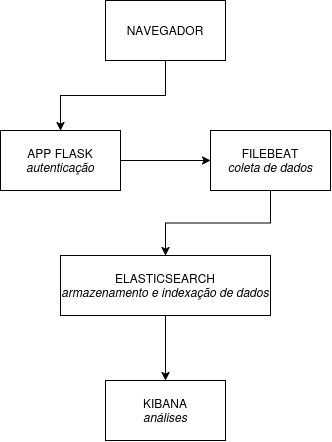

# Central de Logs, Auditoria e Segurança


**Problemática:** Uma aplicação web possui um sistema de autenticação utilizado por diferentes usuários. Em determinado momento, o servidor começa a receber diversas tentativas consecutivas de login, principalmente para uma conta específica.

A equipe responsável precisa investigar os registros para determinar:

- Qual IP realizou as tentativas;
- Qual usuário foi alvo;
- Quando as tentativas ocorreram;
- Quantas tentativas foram realizadas;
- Quantas foram bem-sucedidas ou malsucedidas;
- Se existe um comportamento anômalo.

A análise direta dos arquivos de log torna essa investigação pouco prática. Dessa forma, os eventos são centralizados utilizando a *Stack ELK*.

**Este projeto implementa uma infraestrutura de centralização e análise de logs utilizando a *Stack ELK*, com o objetivo de identificar possíveis comportamentos anômalos relacionados a múltiplas tentativas de autenticação malsucedidas em uma aplicação web.**

A prática envolve:
- Implementação de uma aplicação web com **Flask**;
- Registro estruturado das tentativas de autenticação;
- Geração dos eventos em formato **JSON**;
- Coleta dos logs utilizando **Filebeat**;
- Armazenamento e indexação utilizando **Elasticsearch**;
- Análise dos eventos utilizando **Kibana**;
- Identificação de possíveis comportamentos anômalos.


## Arquitetura

A infraestrutura da prática segue o seguinte fluxograma:

<p align="center">
    
</p>

Certifique-se de ter instalados em sua máquina os itens solicitados em [requirements](req.txt):


## Execução e Testes

### 1. Subir a Stack ELK com Docker

Navegue até o diretório raiz do projeto e execute os containers em segundo plano:

```bash
sudo docker compose up -d
```

Verifique se todos os containers estão ativos (`elasticsearch`, `kibana`, `filebeat` e `flask-app`):

```bash
sudo docker compose ps
```

*Aguarde cerca de 30 a 60 segundos para que o Elasticsearch inicialize completamente.*

---

### 2. Executar a Aplicação e Gerar Logs

Para que o Kibana consiga reconhecer os dados, a aplicação precisa gerar eventos de autenticação.
No terminal (com o ambiente virtual ativo):

```bash
python3 main.py
```

Este script executará os 3 cenários de teste sequencialmente.

---

### 3. Configurar o Kibana

- Abra o navegador e acesse: **`http://localhost:5601`**
- Acesse o menu lateral esquerdo (`≡`) e vá para **Management > Stack Management**.
- Sob a seção **Kibana**, clique em **Data Views** (ou *Index Patterns*).
-. Clique no botão azul **Create data view**.
- Preencha os campos da seguinte forma:
   - **Name:** `auditoria-auth-*`
   - **Index pattern:** `auditoria-auth-*` *(O Kibana indicará correspondência se os logs já tiverem sido gerados)*
   - **Timestamp field:** Selecione `@timestamp`
- Clique no botão **Save data view to Kibana**.

---

### 4. Análise e Auditoria no Kibana

Com o Data View criado, navegue até a seção **Discover** no menu lateral esquerdo:

- **Ajustar o Filtro Temporal:** No canto superior direito, defina o período de tempo como *Last 15 minutes* ou *Last 1 hour*.
- **Filtrar por Falhas:** Na barra de pesquisa principal do Discover, digite:
   ```text
   status_autenticacao : "FALHA"
   ```
- **Isolar o IP Atacante:** Para investigar o ataque de força bruta (Caso Pior), filtre pelo IP do invasor:
   ```text
   ip_origem : "203.0.113.45"
   ```
- **Visualização por Campos:** Clique em qualquer registro para inspecionar os campos JSON gravados (`@timestamp`, `ip_origem`, `usuario_alvo`, `status_autenticacao`).


## Cenários de Teste

| Cenário | Descrição | Comportamento Esperado |
| :--- | :--- | :--- |
| **Caso Bom** | Usuário legítimo (`usuario_comum`) com pequeno erro de digitação pontual. | Baixa frequência, predominância de sucesso (`200 OK`). |
| **Caso Médio** | Erros de autenticação insistentes moderados. | Alerta visual de falhas consecutivas concentradas. |
| **Pior Caso** | Ataque de Força Bruta automatizado pelo IP `203.0.113.45`. | Avalanche de erros HTTP 401 (`FALHA`), alta taxa em curto intervalo. |


## Estrutura do Projeto

```text
.
├── app/
│   ├── app.py          # Aplicação Flask com   logging JSON customizado
│   └──interface.py     # Interface Tkinter para automação e consulta REST
├── filebeat/
│   └── filebeat.yml    # Configuração de coleta do Filebeat (NDJSON)
├── logs/
│   └── auth_audit.log
├── docker-compose.yml  # Orquestração dos serviços (Elasticsearch, Kibana, Filebeat, App)
├── Dockerfile          # Instruções de build da aplicação Flask
├── main.py             # Script CLI para automação dos 3 cenários
├── README.md           # Documentação do projeto
└── req.txt             # Dependências Python
```

## Segurança e Escopo
Esta prática possui finalidade estritamente educacional, todos os testes são executados em ambiente local isolado por containers.